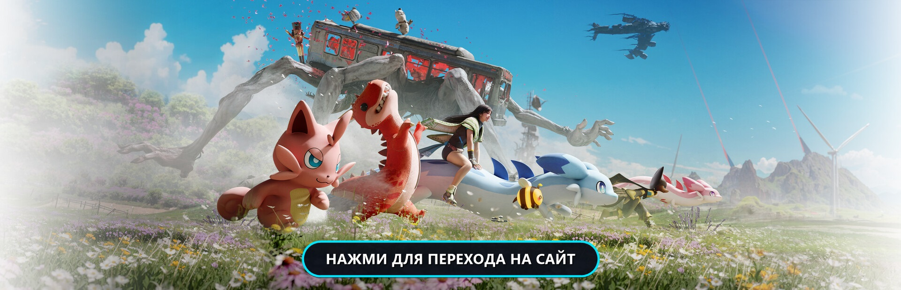

# 🌌 Once Human — Deviants & Shiny Morphs Wiki

[](https://music1703.github.io/once-human-wiki/)
[](https://web.dev/progressive-web-apps/)
[](#-правовая-информация-и-отказ-от-ответственности-disclaimer)

<p align="center">
  <a href="https://music1703.github.io/once-human-wiki/">
    
  </a>
</p>

> 🌐 **[👉 Открыть интерактивную энциклопедию девиантов онлайн](https://music1703.github.io/once-human-wiki/)**

Интерактивная русскоязычная база знаний и каталог редких цветовых вариаций (**Shiny / Morph Deviants**) для постапокалиптической онлайн-игры **Once Human**.

Сайт доступен прямо в браузере, оптимизирован для ПК и мобильных устройств, а также работает как прогрессивное веб-приложение (**PWA**) даже без подключения к интернету.

---

## 🌟 Основные возможности

- 🧬 **Полная энциклопедия девиантов:**
  - Детальные карточки для всех боевых, территориальных и крафтовых девиантов.
  - Удобное разделение на 4 основные категории: **Все**, **⚔️ Боевые**, **🏡 Территориальные**, **🔨 Ремесло / Крафт** со встроенными счётчиками.
  - Понятные инструкции: сценарии (*Manibus*, *The Way of Winter*, *Prismverse*), типы источников (Бункеры сдерживания, Монолиты, открытый мир) и подробный **способ поимки**.
  - Оптимальные условия содержания (**Mood Boosters**): свет, музыка, температура и окружение для 100% эффективности.
  - Список лучших рекомендуемых врождённых черт характера (**Traits**) прямо внутри карточки выбранного морфа.

- 🌈 **Каталог редких морфов и система избранного (250+ Shiny Deviants):**
  - Обширная база данных всех редких цветовых вариаций и эксклюзивных скинов девиантов.
  - Интерактивный предпросмотр скина прямо в модальном окне с описанием уникальных бонусов морфа.
  - **Персональный избранный морф:** выберите любимый скин (например, *«Инфразвуковая иллюзия»* для Пространственного куба) и нажмите **«Сделать этот морф основным»** — девиант сразу обновится в каталоге с артом и бейджем выбранного морфа, а при следующем открытии покажет именно его!
  - Счётчик любимых морфов в шапке с мгновенным сохранением настроек в браузере.

- 📜 **Интерактивная база перков (черт характера):**
  - Выделенный раздел со всеми топовыми врождёнными чертами девиантов Once Human.
  - Удобное разделение на те же категории, что и у девиантов: **Все**, **⚔️ Боевые**, **🏡 Территориальные**, **🔨 Ремесло / Крафт** с динамическими счётчиками.
  - Мгновенный переход к подходящим девиантам по клику на карточку черты.

- 🔍 **Мгновенный поиск:**
  - Быстрый поиск в реальном времени по русским и английским названиям, описаниям, способностям и названиям редких морфов.

- ⚡ **PWA и Офлайн-режим:**
  - Service Worker с интеллектуальным кэшированием для быстрой загрузки и работы без интернета.
  - Возможность установки как на рабочий стол ПК, так и на главный экран Android / iOS.

---

## 📖 Источники данных (Credits & Data Sources)

Вся информация, характеристики, описания и визуальные материалы собраны и систематизированы из **открытых общедоступных источников** сообщества игроков Once Human:

1. 🌐 **[Wikily.gg Once Human Deviations](https://wikily.gg/ru/once-human/deviations/)** — база данных отклонений, скинов, иконок и редких цветовых морфов.
2. 📚 **[Once Human Fandom Wiki](https://oncehuman.fandom.com/)** — справочные материалы по механикам, бункерам и сценариям.
3. 🎮 **Официальные патчноуты и материалы Once Human** — публикации разработчиков Starry Studio и NetEase Games.
4. 👥 **Сообщество игроков Once Human** — опыт фармы, подтверждённые способы поимки и механики настроения девиантов.

---

## ⚖️ Правовая информация и отказ от ответственности (Disclaimer)

- Данный сайт является **неофициальным некоммерческим фанатским проектом**, созданным исключительно в **ознакомительных, справочных и образовательных целях**.
- Все торговые марки, логотипы, названия игры, персонажей, девиантов, предметов, а также графические и аудиовизуальные материалы принадлежат их законным правообладателям — **Starry Studio** и **NetEase Games**.
- Автор проекта не претендует на права интеллектуальной собственности разработчиков. Использование материалов осуществляется в рамках добросовестного использования (*Fair Use*).
- Сайт распространяется бесплатно, не содержит встроенных покупок и коммерческой рекламы. Ссылки на сообщества (Discord, Twitch) служат для общения игроков и обратной связи.
- Если вы являетесь правообладателем какого-либо материала и желаете внести уточнения или запросить удаление контента, пожалуйста, свяжитесь с нами через GitHub Issue.

---

## 📁 Структура проекта

```text
OnceHumanWiki/
├── index.html              # Разметка интерфейса (шапка, категории, каталог девиантов, модальные окна)
├── style.css               # Стилизация (темная тема, категории, карточки, морфы, адаптивность)
├── script.js               # Логика каталога (поиск, фильтрация по категориям, избранные морфы, база перков)
├── sw.js                   # Service Worker для офлайн-доступа и кэширования (PWA)
├── manifest.json           # Манифест прогрессивного веб-приложения (PWA)
├── .gitignore              # Исключения версионного контроля
├── README.md               # Документация проекта
├── data/
│   ├── deviants.json       # База всех базовых девиантов, категорий, способностей и условий содержания
│   └── variants.json       # База редких морфов (250+ вариантов, характеристики и пассивные бонусы)
├── icons/                  # PWA-иконки и фавиконки приложения
└── images/                 # Локальные медиа-ресурсы
    ├── banner.jpg          # Интерактивный промо-баннер для README
    └── variants/           # Локальные webp-изображения ключевых морфов
```

---
